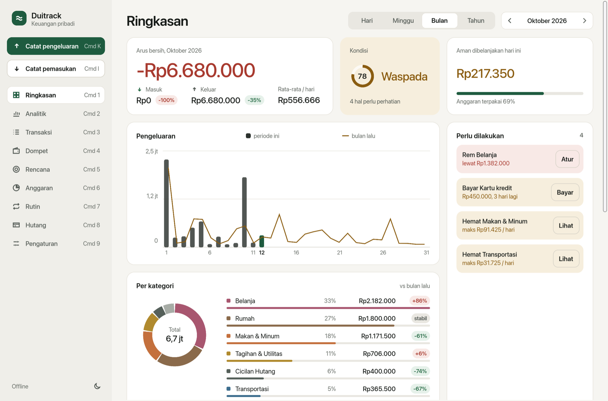
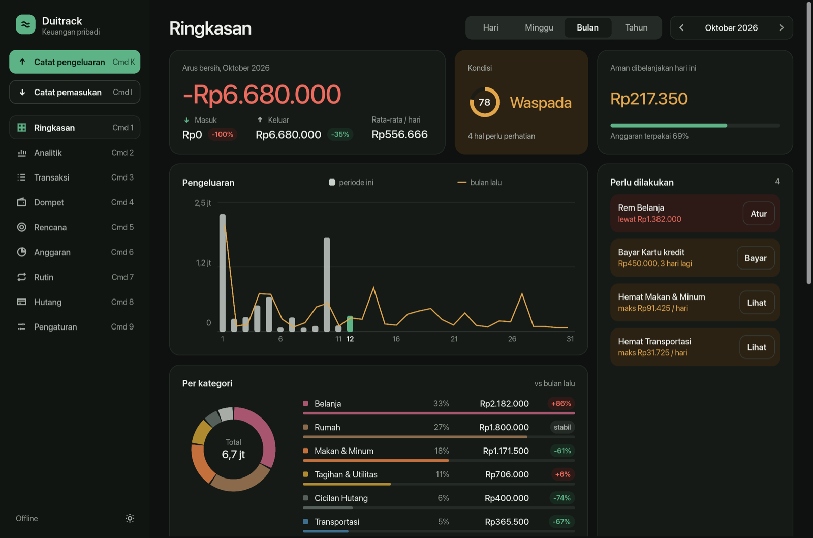
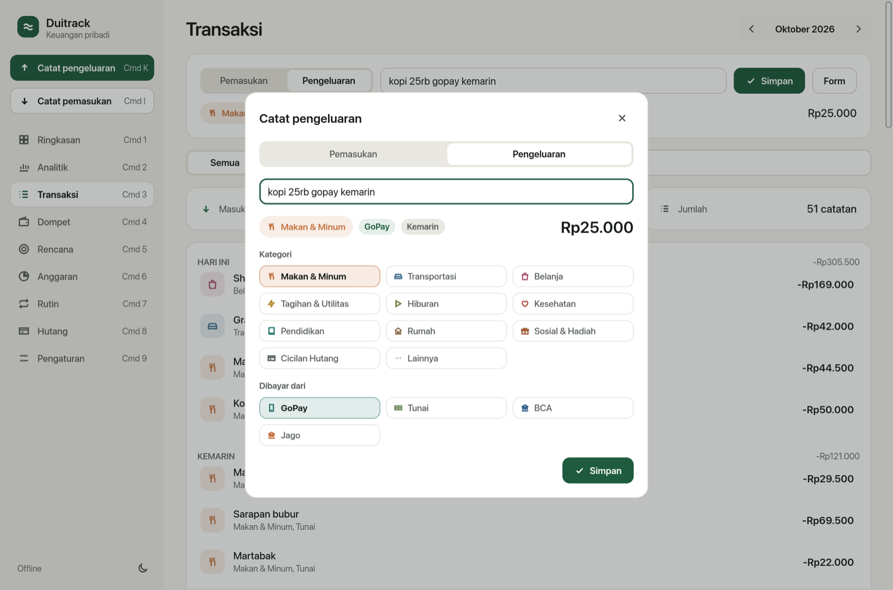
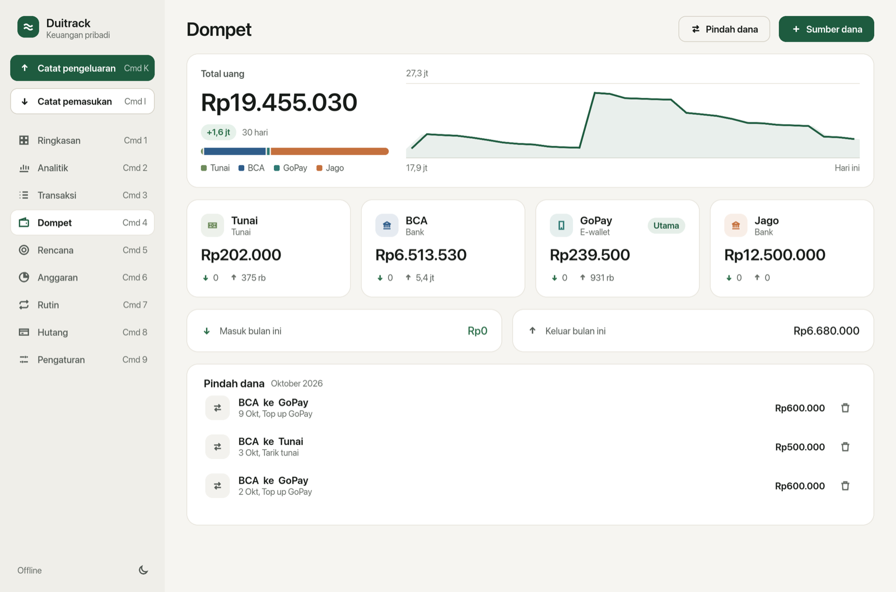
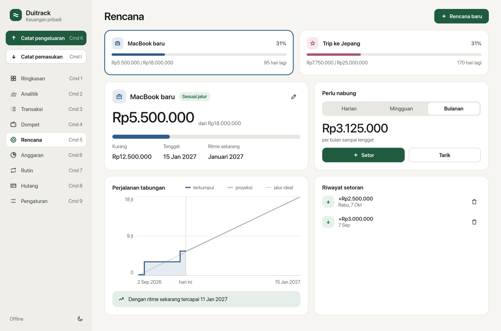
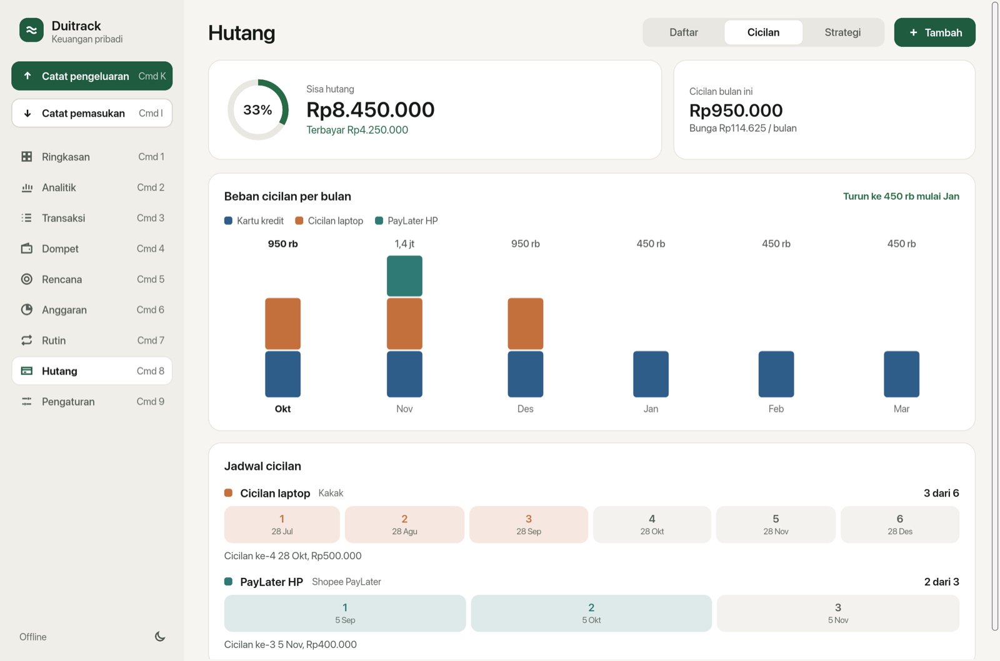
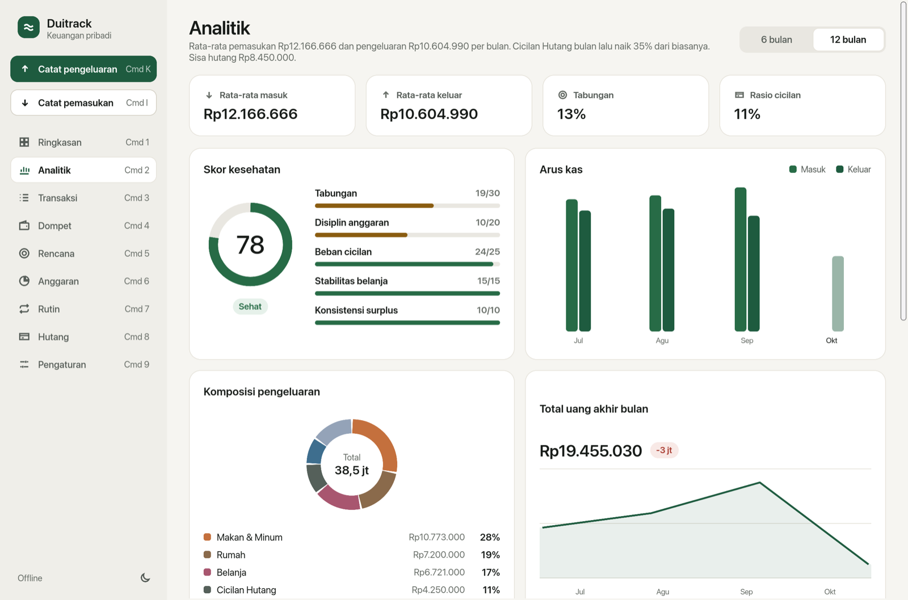

# Duitrack

Aplikasi pencatat dan perencana keuangan pribadi untuk macOS. Ditulis penuh dengan Rust, tanpa webview, tanpa internet, tanpa AI. Semua angka dihitung dari aturan yang bisa dijelaskan, dan semua data tinggal di Mac kamu.

Dibuat oleh **Brian**, [adefebrian.com](https://adefebrian.com), [github.com/adefebrian](https://github.com/adefebrian).



## Performa

Diukur di Mac Apple Silicon, build rilis, data contoh 4 bulan (441 transaksi).

| Ukuran | Hasil |
|---|---|
| Ukuran app (`Duitrack.app`) | 13 MB, satu binary native |
| Memori saat terbuka | sekitar 115 MB |
| CPU saat diam | 0% (UI hanya menggambar ulang saat ada perubahan) |
| Internet | tidak dipakai sama sekali |
| Database | SQLite lokal (WAL), satu file |

Kecepatan mesin perhitungan, per panggilan:

| Operasi | Waktu |
|---|---|
| Membaca teks "kopi 25rb gopay kemarin" | 0,04 ms |
| Ringkasan bulan + wawasan otomatis | 0,7 ms |
| Tampilan Hari / Minggu / Bulan / Tahun | 0,03 sampai 0,2 ms |
| Analitik 12 bulan | 0,66 ms |
| Simulasi pelunasan hutang | 0,02 ms |
| Total uang semua sumber dana | 0,06 ms |

Ulangi sendiri dengan:

```sh
cargo run --release -p moneycore --example bench
```

Kenapa ringan: UI dirender langsung oleh [Slint](https://slint.dev) di GPU, tanpa browser engine seperti Electron atau Tauri. Semua logika ada di crate Rust `moneycore` dan dihitung ulang hanya saat data berubah.

## Fitur

### Ringkasan
Dashboard utama dengan filter **Hari, Minggu, Bulan, Tahun**, yang selalu dibandingkan dengan periode sebelumnya.
- Arus bersih, pemasukan, pengeluaran, dan rata-rata per hari, plus persen naik atau turunnya.
- **Kondisi** keuangan (Sehat, Waspada, Kritis) dengan warna yang mengikuti keadaan.
- **Aman dibelanjakan hari ini**: sisa anggaran dibagi sisa hari, tidak pernah melebihi uang yang benar-benar kamu punya.
- Grafik pengeluaran dengan garis periode pembanding dan tooltip.
- Komposisi per kategori.
- **Perlu dilakukan**: tagihan yang jatuh tempo, cicilan yang harus dibayar, dan kategori yang lewat anggaran, masing-masing dengan tombol aksi.



### Catat pengeluaran dan pemasukan
Dua tombol terpisah, **Catat pengeluaran** (Cmd K) dan **Catat pemasukan** (Cmd I). Ketik seperti chat, misalnya `kopi 25rb gopay kemarin` atau `gaji 8,5jt bca tgl 25`. Duitrack membaca:
- nominal (`25rb`, `1,5jt`, `32.500`)
- tanggal (`kemarin`, `sabtu`, `tgl 5`, `5/10`)
- kategori, dari kata kunci yang bisa kamu atur sendiri. Setiap kali kamu mengoreksi kategori, Duitrack ikut belajar.
- sumber dana (`gopay`, `bca`, `tunai`)

Kolom nominal di form otomatis memberi titik ribuan saat diketik, jadi `45000000` tampil sebagai `45.000.000`.



### Dompet
Sumber dana (bank, e-wallet, tunai) dengan saldo masing-masing. Ada fitur pindah dana antar sumber (top up, tarik tunai), total uang dari semua sumber, dan tren 30 hari.



### Rencana
Target tabungan, bisa lebih dari satu sekaligus (trip, gadget, dana darurat).
- Target, tenggat, ikon, dan warna.
- Hitungan **perlu nabung** per hari, minggu, atau bulan supaya tepat waktu.
- Status Sesuai jalur, Lebih cepat, Tertinggal, atau Lewat tenggat.
- Grafik terkumpul vs jalur ideal, plus proyeksi dengan ritme sekarang ("tercapai 11 Jan 2027" atau "kurang Rp X di tenggat").
- Riwayat setor dan tarik.



### Hutang dan cicilan
- **Cicilan tetap** (misalnya 6x atau 3x, paylater, pinjaman keluarga) lengkap dengan jadwal cicilan ke-1 sampai N dan status lunas, segera, atau telat.
- **Hutang fleksibel** (kartu kredit) dengan bunga, biaya, dan bayar minimum.
- **Beban cicilan per bulan**, jadi kelihatan kapan beban turun.
- Simulasi strategi **Avalanche vs Snowball** dengan setoran tambahan.



### Anggaran, Rutin, Analitik
- **Anggaran** per kategori, dengan saran otomatis dari median belanja 3 bulan terakhir.
- **Rutin**: gaji, sewa, langganan. Ada pengingat jatuh tempo, dan semuanya ikut dihitung dalam prediksi akhir bulan.
- **Analitik**:
  - skor kesehatan finansial dengan 5 komponen yang bisa dijelaskan
  - arus kas per bulan
  - total uang per akhir bulan
  - komposisi pengeluaran
  - pola belanja per hari
  - tingkat tabungan
  - kepatuhan anggaran



### Cara Duitrack berpikir (tanpa AI)
- **Prediksi akhir bulan**: memadukan ritme bulan ini dengan rata-rata 3 bulan. Tagihan rutin dan cicilan dihitung terpisah supaya tidak ikut dikali per hari.
- **Transaksi tidak biasa**: dideteksi dengan median dan simpangan baku per kategori.
- **Langganan tersembunyi**: dideteksi dari catatan yang berulang tiap bulan dengan nominal stabil.
- **Peringatan**: saldo yang minus, dan cicilan yang tidak menutup bunga.

### Lainnya
- Mode terang, malam, atau ikuti sistem. Kontras teks minimal 4,5:1 di kedua mode.
- Animasi bisa diatur: selalu, ikuti Reduce Motion, atau mati.
- Kategori, sumber dana, dan rencana bisa ditambah sendiri, lengkap dengan ikon dan warnanya.
- Cadangan dan pemulihan dalam satu file JSON.

## Menjalankan

Butuh Rust (stable) di macOS.

```sh
cargo run -p duitrack              # mode pengembangan
./scripts/bundle.sh                # build rilis -> dist/Duitrack.app
cp -R dist/Duitrack.app /Applications/
cargo test                         # test mesin perhitungan
```

Data tersimpan di `~/Library/Application Support/Duitrack/duitrack.db`.

## Struktur

```
crates/moneycore   mesin: SQLite, parser teks, prediksi, wawasan, hutang, rencana, analitik
app/ui             tampilan Slint (design tokens di theme.slint)
app/src            penghubung UI dan mesin
scripts            bundle .app dan ikon
```

Opsi pengembangan: `DUITRACK_DB=/tmp/x.db`, `DUITRACK_TODAY=2026-10-12`, `--demo`, `--page N`, `--theme N`. Dengan `--features snap`, opsi `--snap out.png` merender jendela ke PNG lalu keluar.

---

Duitrack, dibuat oleh Brian. [adefebrian.com](https://adefebrian.com), [github.com/adefebrian](https://github.com/adefebrian)
